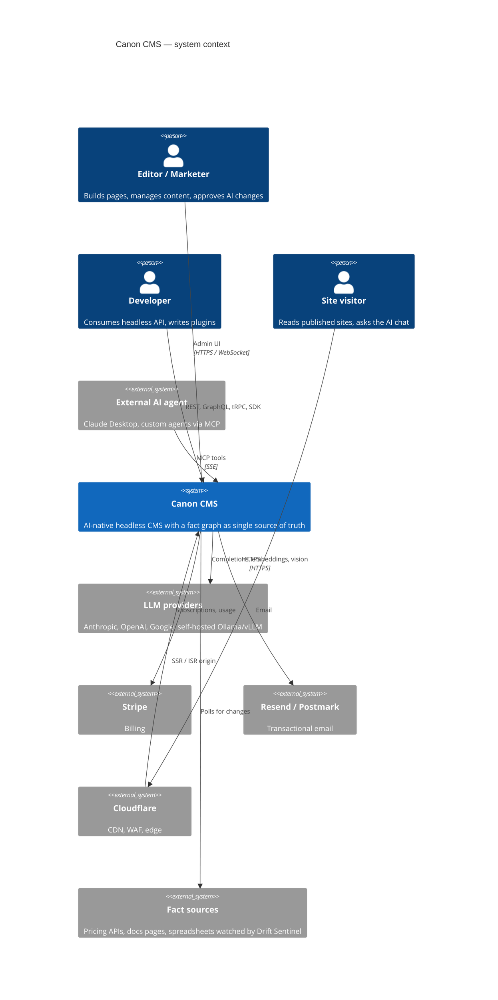
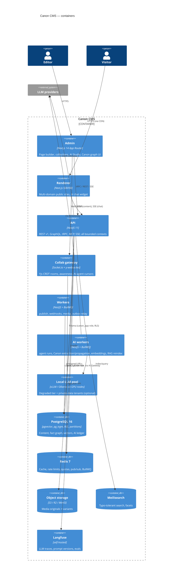
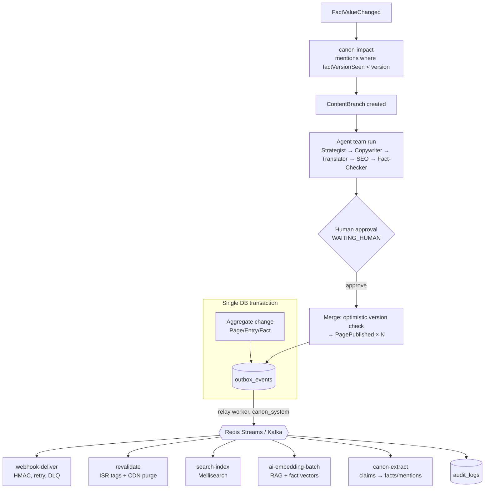
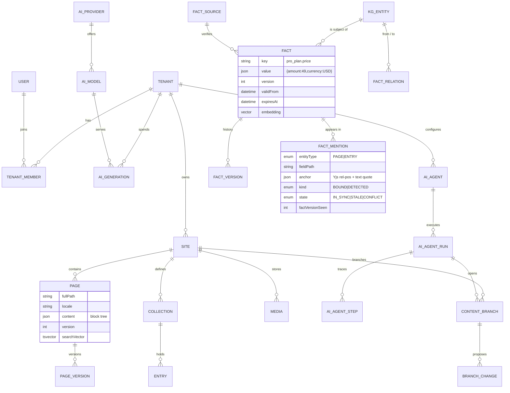

# Canon CMS — Architecture

Modular monolith (NestJS) with DDD bounded contexts, ready to split along the same seams.
The **Intelligence** context (AI gateway, agents, RAG, Canon fact graph) has its own workers and
infrastructure (GPU pool, embedding queues) from day one.

## 1. C4 — System context



## 2. C4 — Containers



## 3. C4 — Components of the Intelligence context

```mermaid
flowchart LR
  subgraph Presentation
    AIC[AiController<br/>REST + SSE]
    MCP[MCP server<br/>Phase 7]
    Q[BullMQ consumers<br/>agent-run, canon-*, embed]
  end
  subgraph Application
    GW[AiGateway<br/>route · fallback · cache · guard · cost]
    AR[Agent Runtime<br/>LangGraph state machines]
    RAG[RAG pipeline<br/>chunk · embed · hybrid search]
    CAN[Canon services<br/>extract · resolve · lint · propagate]
  end
  subgraph Ports
    P1[[LlmProvider]]
    P2[[ModelCatalog / TenantPolicy]]
    P3[[Quota]]
    P4[[Exact / Semantic cache]]
    P5[[Guardrails]]
    P6[[UsageRecorder / Tracer]]
  end
  subgraph Adapters
    A1[Anthropic · OpenAI · Gemini · Ollama]
    A2[(ai_models / tenants)]
    A3[(Redis counters)]
    A4[(Redis · pgvector)]
    A5[Heuristic · Lakera/NeMo]
    A6[(ai_generations) · Langfuse · Prometheus]
  end
  AIC --> GW
  MCP --> CAN
  Q --> AR & CAN & RAG
  AR --> GW
  CAN --> GW
  RAG --> GW
  GW --> P1 & P2 & P3 & P4 & P5 & P6
  P1 --> A1
  P2 --> A2
  P3 --> A3
  P4 --> A4
  P5 --> A5
  P6 --> A6
```

## 4. AI request flow (gateway)

```mermaid
sequenceDiagram
  autonumber
  participant C as Caller (API / worker / agent)
  participant G as AiGateway
  participant GR as Guardrails
  participant QT as Quota (Redis)
  participant CA as Cache (Redis exact · pgvector semantic)
  participant P1 as Primary model
  participant P2 as Fallback model(s)
  participant R as Recorder (ai_generations · Langfuse · Prometheus)

  C->>G: complete(request, ctx{tenant, feature})
  G->>GR: inspectInput (injection, PII)
  alt blocked
    G->>R: BLOCKED
    G-->>C: 422 AI_BLOCKED_BY_GUARDRAIL
  end
  G->>G: candidate chain = requested → tenant default → fallbacks<br/>(filtered by allow-list, capabilities, configured providers)
  G->>QT: check(rate/min, monthly budget)
  alt over limit
    G-->>C: 429 / 402
  end
  G->>CA: lookup (exact key; semantic if Q&A)
  alt hit
    G->>R: SUCCEEDED, cacheHit, cost 0
    G-->>C: cached result
  end
  loop each candidate (breaker per provider)
    G->>P1: request (retry ×2 with jitter on 429/5xx/network)
    alt success
      P1-->>G: text + usage
      G->>GR: inspectOutput
      G->>QT: commit(cost µ$)
      G->>CA: store
      G->>R: SUCCEEDED
      G-->>C: result
    else refusal
      Note over G: terminal — never re-routed to bypass model safety
    else failure
      G->>P2: next candidate
    end
  end
  G->>CA: semantic lookup (looser threshold)
  G->>R: DEGRADED / FAILED
  G-->>C: degradeWith text (200 DEGRADED) or 503
```

Streaming uses the same pipeline; fallback is possible only until the first token is sent
(`peekFirst` puts connect + TTFT inside the breaker/retry scope).

## 5. Domain events & sagas



Events are versioned (`outbox_events.schemaVersion`); consumers upcast older payloads.
Core events: `Page{Created,Updated,Published,Scheduled,Unpublished,Deleted}`, `Entry*`,
`Media{Uploaded,Deleted}`, `User{Invited,Joined,RoleChanged}`, `AbTest{Started,Completed}`,
`FormSubmitted`, `Webhook{Delivered,Failed}`, `AiGeneration{Requested,Completed,Failed}`,
`AgentTask{Started,Progressed,Completed}`, `ContentQualityScored`, `RagIndexUpdated`,
`EmbeddingGenerated`, and Canon's `Fact{Created,ValueChanged,Deprecated}`,
`Mention{Detected,Stale,Conflict}`, `Branch{Opened,Merged}`.

## 6. ERD (core + Canon)



Full schema: [`packages/db/prisma/schema.prisma`](../packages/db/prisma/schema.prisma) — 47 models.

## 7. Multi-tenancy & data protection

| Layer | Mechanism |
|---|---|
| Resolution | subdomain → custom domain → `x-tenant` header (API keys) → JWT claim (Phase 1) |
| App layer | repositories always filter by `tenantId`; tenant id never read from request bodies |
| DB layer | RLS on every tenant table, `FORCE ROW LEVEL SECURITY`, policies on `app.tenant_id` GUC set per transaction (`SET LOCAL` semantics) — fail-closed |
| Roles | `canon` owner (migrations), `canon_app` runtime (RLS applies), `canon_system` BYPASSRLS for cross-tenant workers |
| Audit | `audit_logs` partitioned monthly; `canon_app` has no UPDATE/DELETE on it |
| Scale-out | Enterprise: schema-per-tenant (`Tenant.isolation = SCHEMA`) → database-per-tenant, same code via datasource routing |

Verified in Phase 0 against a live Postgres: no GUC → 0 rows; foreign tenant → 0 rows;
cross-tenant INSERT → `violates row-level security policy`; `DELETE FROM audit_logs` → permission denied.

## 8. Key decisions

| Decision | Choice | Why |
|---|---|---|
| ORM | **Prisma 6** | Mature migrations + client extensions (RLS), team familiarity. pgvector/tsvector/HNSW handled via `Unsupported` + raw SQL; drift verified empty. Drizzle would model pgvector natively but loses Prisma's migration/introspection DX. |
| NestJS | **11** (spec said 10) | 10 is two majors behind in 2026; nestjs-pino and other ecosystem packages require 11+. |
| Model IDs | Data in `ai_models` | Providers ship models monthly; routing/pricing changes are a seed/DB update, not a deploy. |
| Fallback on refusal | **No** cross-provider retry | Re-routing a safety refusal would turn the fallback chain into a jailbreak path. |
| Langfuse client | Direct ingestion HTTP API | Stable across v2/v3 self-hosted; SDK majors churned. |
| Cost unit | Integer micro-USD | Exact sums over millions of calls; `price/1M × tokens` is already µ$. |
| Partitions | Child tables in schema `partitions` | Prisma diffs only `public`, so partitions never show as drift. |
| HNSW indexes | Partial (`embedding IS NOT NULL`) | Excludes rows awaiting embeddings; Prisma ignores partial indexes (no drop proposals). |
