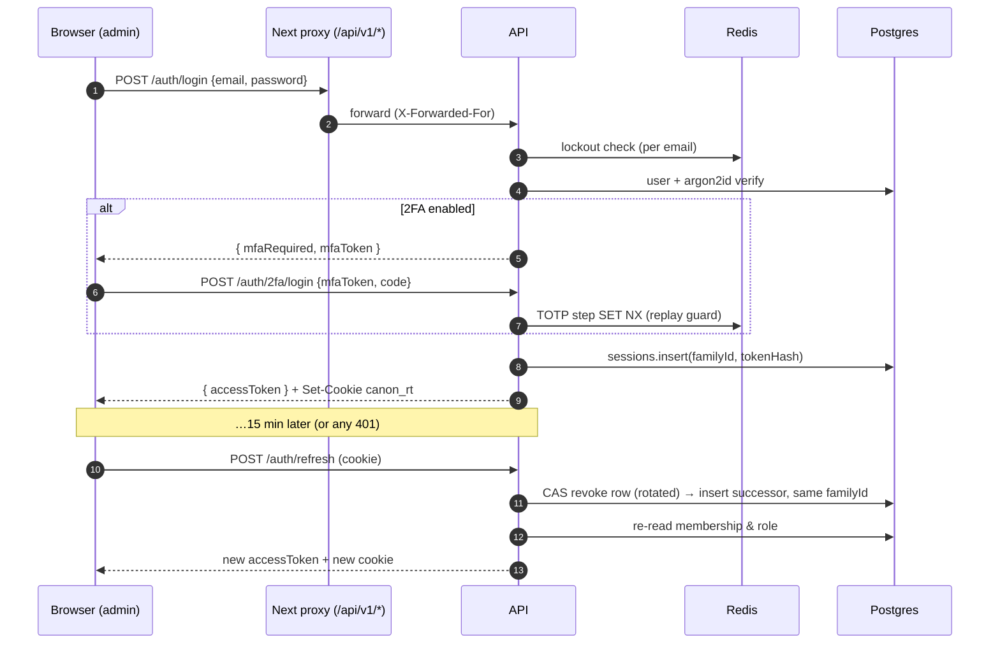

# Auth, tenancy & AI quotas (Phase 1)

## Credentials

| Credential | Format | Lifetime | Where it lives |
|---|---|---|---|
| Access token | JWT HS256 `{sub, sid, tid, trl, srl, typ}`, aud `canon-api` | 15 min | Browser memory only (never `localStorage`) |
| Refresh token | 256-bit opaque, SHA-256 in `sessions` | 30 days absolute, rotated on every use | httpOnly, `SameSite=Strict`, `Secure` (prod) cookie `canon_rt`; body only for `x-canon-client: native` |
| MFA challenge | JWT, aud `canon-mfa` | 5 min | Returned by `/auth/login` when 2FA is on |
| API key | `ck_<8 lookup>_<256-bit secret>`, SHA-256 stored | optional expiry | Integrations, CI, AI agents (`x-api-key` or Bearer) |



## Defences

- **Refresh reuse detection.** A rotated token presented again outside a 15 s race window is treated as theft. The whole family is revoked, the attacker and the victim are both logged out, and the event is logged as `auth.refresh_token_reuse_detected`.
- **Instant revocation.** Access tokens are stateless, but each request checks a Redis deny-list keyed by `sid` (the session family). Logout, "sign out device", password change and role changes take effect immediately, not when the token expires.
- **Role changes force a refresh.** Demoting or removing a member deny-lists their access tokens for that tenant. The next refresh re-reads the role from the DB. Tokens never outrank the database.
- **Enumeration resistance.**
  - Register, forgot-password and resend always return 202 with the same body.
  - Login returns the same 401 for an unknown email and for a wrong password; a dummy argon2 verify equalises timing.
  - Account state (unverified, disabled) is revealed only after the correct password.
- **Brute force.**
  - Per-email lockout: 5 failures → 15 min. It is keyed by the submitted email whether or not the account exists.
  - The 2FA step shares the same lockout budget.
  - Per-IP sliding-window limits on all credential endpoints.
- **Passwords.**
  - argon2id with m=19 MiB, t=2.
  - zxcvbn score ≥ 3 against a 10–128 character range.
  - Passwords containing the user's own name or email parts are rejected, because zxcvbn alone accepts `ada.lovelace2026`.
- **2FA.**
  - TOTP is RFC 6238, implemented in-house and tested against the RFC vectors.
  - The secret is stored AES-256-GCM-encrypted.
  - The QR code is rendered client-side.
  - Each time step works once (Redis replay guard).
  - 10 single-use backup codes, consumed via a conditional array update.
- **CSRF.**
  - Cookie-authenticated endpoints (`refresh`, `logout`, `switch-tenant`) rely on `SameSite=Strict` and also reject untrusted `Origin` values.
  - All other endpoints use Bearer tokens, which CSRF cannot forge.
- **Client IP.** `TRUST_PROXY` trusts internal networks instead of a hop count, so browser → ingress → Next → API and SDK → ingress → API both resolve the real client.

## Authorization

Three independent layers. Any one of them is enough to stop a cross-tenant access.

1. **Credential-bound tenant.** The tenant comes from the JWT `tid` or from the API key's tenant, never from the request. `/tenants/:id/*` rejects any `:id` that is not the active tenant (`TENANT_MISMATCH`).
2. **CASL abilities** (`common/auth/abilities.ts`). Routes declare `@RequirePermission(action, subject)`. Services check instances with `subject('Member', row)`. Every rule carries `{tenantId}`.
3. **Postgres RLS** on the `canon_app` role. No `app.tenant_id` set means no rows (verified in the integration tests).

| | OWNER | ADMIN | EDITOR | AUTHOR | VIEWER | API key |
|---|---|---|---|---|---|---|
| Content (pages, entries, media, facts…) | manage | manage | CRUD + publish | create; edit/delete **own** | read | per scope |
| Members / invitations | manage | manage except OWNER rows; cannot mint owners | read | read | read | — |
| API keys | manage | manage | — | — | — | — |
| Tenant delete, billing | ✓ | — | — | — | — | — |
| Invoke AI | ✓ | ✓ | ✓ | ✓ | — | `ai:invoke` |
| AI usage | ✓ | ✓ | read | — | — | `ai:usage:read` |

API key scopes are `content:read`, `content:write`, `content:publish`, `media:write`, `ai:invoke`, `ai:usage:read`, `canon:read`, `canon:write` and `analytics:read`. Agent keys (`isAgentKey`) default to 120 req/min and are recorded as `aiInvolved` in the audit log.

Invariants enforced by the services:
- The last OWNER cannot be demoted or removed.
- Only owners grant ownership.
- Invitations bind to the invited email.
- Unverified users cannot invite anyone.
- Pending invitations count against plan seats.

## Tenancy

- Signing up creates a FREE workspace with the user as OWNER. `POST /tenants` creates more; `switch-tenant` rotates the session into another one.
- The runtime role creates a tenant inside a transaction that already runs under the new tenant's RLS context. Slug availability is checked once through the system role, and the unique index decides any race.
- Plan limits are defined in `modules/tenancy/plans.ts`. Per-tenant overrides live in `Tenant.quota` (negotiated enterprise limits, support grants).

## AI quotas

| | FREE | PRO | BUSINESS | ENTERPRISE |
|---|---|---|---|---|
| Model tiers | economy, local | + standard | + premium | all |
| Tokens / month | 200k | 5M | 50M | ∞ |
| Requests / min (workspace / user) | 10 / 5 | 60 / 20 | 300 / 60 | 2000 / 200 |
| Concurrent requests | 2 | 5 | 20 | 100 |
| Default budget | $5, **hard stop** | $100, soft | $1000, soft | none |

- **Pre-flight.** Requests are checked against the per-minute limits (workspace and user), the token allowance and the budget. Token and cost estimates use the input size plus `maxTokens`.
- **Concurrency.** A Redis sorted-set semaphore holds a slot per request. The slot expires on its own if the worker dies, and it is released in `finally`, including when a stream is abandoned.
- **Budget behaviour.** Soft-limit plans keep working past the budget and alert at 50/80/100%. The alert goes to owners and admins as an in-app notification plus email, once per threshold per month.
- **Counters.**
  - Redis counters are re-seeded from `ai_generations` when missing, so a Redis flush cannot reset anyone's budget.
  - `ai_generations` remains the billing source of truth.
  - On a Redis outage, quota checks fail open.
- **Usage reporting.** `GET /v1/ai/usage` returns totals, breakdowns by feature, model and day, the cache-hit rate, a month-end forecast and the plan limits.

## Endpoints added in Phase 1

```
POST /v1/auth/register | verify-email | verify-email/resend | login | 2fa/login | refresh | logout
POST /v1/auth/forgot-password | reset-password | change-password | switch-tenant
POST /v1/auth/2fa/enable | 2fa/verify | 2fa/disable | 2fa/backup-codes
GET  /v1/auth/me | sessions          DELETE /v1/auth/sessions/:id
GET  /v1/tenants  POST /v1/tenants   GET|PATCH|DELETE /v1/tenants/:id   GET /v1/tenants/:id/quota
GET  /v1/tenants/:id/members   POST /v1/tenants/:id/members/invite
PATCH|DELETE /v1/tenants/:id/members/:userId
GET  /v1/tenants/:id/invitations   DELETE /v1/tenants/:id/invitations/:invitationId
GET  /v1/invitations/:token (public)   POST /v1/invitations/accept
GET|POST /v1/api-keys   DELETE /v1/api-keys/:id   GET /v1/api-keys/scopes
GET  /v1/ai/usage   GET /v1/tenants/:id/ai-usage
```

Deferred by plan: OAuth social login, WebAuthn/passkeys and SAML/OIDC SSO move to Phase 7 (Enterprise). The session and principal model already accommodates them: each is just another way to call `startSession`.
