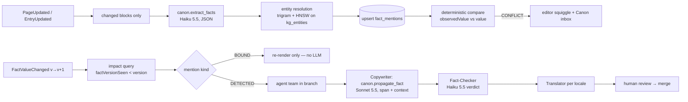

# Canon — the fact graph

> **Change a fact once — the site rewrites itself.**

## Problem

Every company's site states the same facts dozens of times: the Pro price, the number of
integrations, the SLA, the CEO's name, the support hours. They live in pricing blocks, FAQ
answers, blog posts, emails, five translations and the AI chat's answers. When one changes,
editors find-and-replace and still miss copies ("$39" in the German FAQ, "under $50" in a 2024
post). The result is contradictions, legal exposure, broken trust and SEO cannibalisation.
No CMS knows **what its content claims**. They only know which strings it holds.

## Solution

Canon keeps a typed knowledge graph of claims and ties every span of content to the claim it states.

| Concept | Table | Notes |
|---|---|---|
| Entity | `kg_entities` | Thing facts are about (plan, product, person). Embedding for alias resolution. |
| Fact | `facts` | `(subject, predicate) → typed value`, stable `key` (`pro_plan.price`), `validFrom/validUntil`, freshness `expiresAt`, `version`. |
| Fact history | `fact_versions` | Append-only; origin USER / AGENT / SENTINEL / IMPORT; powers time-travel. |
| Mention | `fact_mentions` | One per span per locale. **BOUND** = `{{fact:key}}` token (deterministic render). **DETECTED** = AI-matched free text. State IN_SYNC / STALE / CONFLICT. |
| Source | `fact_sources` | URL / API / collection the fact is verified against. |
| Branch | `content_branches`, `branch_changes` | All propagation happens in a reviewable branch; merge is atomic with optimistic version checks. |

## Supporting features (same graph)

1. **Consistency Linter**: inline in the editor, "this says $39, Canon says $49". It runs on every save from structured values. Numbers, dates and money compare deterministically, so it needs no LLM.
2. **Impact Analysis**: changing a fact shows every page, block, locale and channel it touches before you commit.
3. **Drift Sentinel**: polls `fact_sources`. When a source changes or a fact passes `expiresAt`, it opens a proposal.
4. **Fact time-travel**: "what did the site claim about X on 1 March?" is answered by joining `fact_versions` with `page_versions`, plus an AI explanation of what changed.
5. **Grounded answers + MCP**: the site chat, the RAG answers on the 404 page and external agents (`canon.get_fact`, `canon.search_claims`) answer from canonical facts with per-claim citations.
6. **Cross-locale alignment**: translations share fact ids, so a divergent locale is a lint error, not a silent bug.

## User journeys

1. **Price change (marketer).** Open `pro_plan.price` → set $59 → impact view shows 37 mentions on 21 pages in 3 locales → "Propagate". The agent team opens branch `price-update` and proposes contextual rewrites ("less than $50" becomes "just $59"). The marketer reviews the diff with per-change explanations → approves → merge → ISR revalidates the affected paths.
2. **Writing (editor).** An editor types "120 integrations". The linter recognises `acme.integrations_count` and offers "Bind to fact". The span becomes a BOUND token and can never drift again.
3. **Freshness (ops).** Drift Sentinel sees 140 on the integrations directory, proposes a change (origin SENTINEL) and notifies the fact owner.
4. **Audit (legal).** "Show everything we claimed about refund policy between Jan and Jun." The answer is a timeline of fact versions plus the page versions that rendered each value.
5. **External agent (developer).** Claude Desktop connects over MCP → `canon.search_claims("pricing")` → gets canonical values with sources and the pages that state them.

## Technical design

- **Span anchors** store a Yjs `RelativePosition` and a W3C text-quote selector (`prefix/exact/suffix`). The Yjs position survives collaborative edits. The quote re-anchors after imports or non-Yjs edits.
- **Incremental extraction** runs only on blocks whose hash changed, with an exact-cache hit when the same block content is extracted again. It is batched per page in the `canon-extract` queue.
- **Propagation is not find-replace.** Each DETECTED span gets the sentence before and after it and the brand voice. The model either returns `{"action":"replace"}` or escalates to a human with `{"action":"escalate"}`.
- **Prompts** are `canon.extract_facts`, `canon.propagate_fact` and `canon.fact_check`. They are versioned in `ai_prompts` and regression-tested with promptfoo (Phase 5).

### API surface (Phase 5)

Implemented in Phase 5:

- **Facts**:
  - `GET/POST /v1/canon/facts`, `GET/PATCH/DELETE /v1/canon/facts/:id` (PATCH creates a version and returns the impact);
  - `GET /v1/canon/facts/:id/versions`, `GET /v1/canon/facts/:id/impact?siteId=`;
  - `POST /v1/canon/facts/:id/propagate` (opens a branch and an agent run).
- **Mentions and linting**:
  - `GET /v1/canon/conflicts?siteId=`;
  - `POST /v1/canon/mentions/:id/dismiss`, `POST /v1/canon/mentions/:id/bind`;
  - `POST /v1/canon/lint` (deterministic), `POST /v1/canon/scan` (re-scan one page or entry).
- **Entities and runs**: `GET /v1/canon/entities`, `GET /v1/canon/runs/:id` (run tree with steps).
- **Branches**:
  - `GET /v1/sites/:id/branches`, `GET /v1/branches/:id`;
  - `PATCH /v1/branches/:id/changes/:changeId` (accept, reject, span overrides);
  - `POST /v1/branches/:id/merge` (CAS on the base version, optional publish), `POST /v1/branches/:id/close`.

Not in Phase 5 yet:

- **Later phases**: `GET /v1/canon/timeline` (time-travel), Drift Sentinel (`fact_sources` polling) and Yjs span anchors (Phase 6, together with collaboration).
- **Phase 7**: the MCP tools `canon.get_fact`, `canon.search_claims`, `canon.impact`. Until then, the same read-only operations are available to AI Studio agents as tools.

Deviations from the original design:

- Anchors are text-quote selectors only, and a rescan replaces an entity's mentions while preserving DISMISSED and STALE states.
- A propagation branch holds one change per page or entry: the patched draft plus per-span explanations.

### Infrastructure

- Queues: `canon-extract`, `canon-impact`, `canon-propagate`, `drift-sentinel` (cron) and `ai-embedding-batch`. HPA scales the AI workers on queue depth.
- Vectors: `facts.embedding` and `kg_entities.embedding` use HNSW cosine indexes. Past ~50M vectors per cluster they move to Qdrant (`--profile vector-scale`).
- The GPU pool (vLLM) is optional. It serves extraction for tenants that require private inference, and it is the degraded tier.

## 3-minute demo script

| t | Show |
|---|---|
| 0:00 | Import a 50-page site in 3 locales. The graph builds live: "Pro plan price = $49, 37 mentions". |
| 0:40 | The Canon inbox shows 4 conflicts, including the German FAQ ($39) and a 2024 blog post. Click: the squiggle in the editor. |
| 1:10 | Change the price to $59. The impact view lists 37 mentions on 21 pages. Click "Propagate". Agent cursors appear in the pages (Yjs awareness). |
| 2:00 | Branch `price-update`: per-span diffs with explanations, the Fact-Checker report and translations. Approve → merge → production updates in seconds. |
| 2:40 | Ask the site chat "How much is Pro?" The answer is "$59" with a citation of the canonical fact. Bonus: Drift Sentinel flags "120 integrations" (the source now says 140). |

## LLM cost estimate per 1000 active editors per month

Assumptions: 20 saves/editor/day, 22 working days, ~2k tokens per extraction (delta blocks only),
10 fact changes/editor/month × 20 detected spans, ~2.3k tokens per rewrite incl. fact-check.
Prices from the seeded registry (Haiku 5.5 $0.10/$0.50, Sonnet 5.5 $2/$10 per 1M).

| Pipeline | Volume | Model | Est. cost |
|---|---|---|---|
| Extraction | 440k calls × ~1.6k in / 0.4k out | Haiku 5.5 | ~$160 |
| Propagation | 200k spans × ~1.8k in / 0.3k out | Sonnet 5.5 | ~$1,320 |
| Fact-check | 200k × ~0.8k in / 0.1k out | Haiku 5.5 | ~$26 |
| Embeddings | ~500M tokens | text-embedding-3-small | ~$10 |
| Drift Sentinel + grounded answers | | Haiku/Sonnet | ~$150 |
| **Total** | | | **≈ $1.7k/month ≈ $1.7 per editor** |

BOUND mentions cost nothing to propagate. As editors bind detected spans, propagation cost
falls over time, which is a built-in margin improver. The exact cache absorbs repeated extraction
of unchanged blocks. Batch API (−50%) applies to Sentinel and backfill runs.

## Latency SLAs

| Operation | Target |
|---|---|
| Linter result after save | p95 < 300 ms (deterministic path); AI-detected conflicts < 5 s, async |
| Impact analysis | p95 < 200 ms (indexed `fact_mentions` query) |
| Propagation of 50 spans | < 60 s end-to-end, streamed progress |
| Grounded chat first token | p95 < 1.5 s |

## Fallback when LLMs are unavailable

| Capability | Without LLM |
|---|---|
| Graph, impact analysis, time-travel, branches, merge | Fully available (DB-only) |
| BOUND mention propagation | Fully available (deterministic re-render) |
| Linter for numbers/dates/money on known facts | Available (rule-based on `observedValue`) |
| Extraction from new free text | Queued (BullMQ retries with backoff), then the local Ollama/vLLM tier |
| Contextual rewrite of DETECTED spans | Queued. The editor can apply a suggested literal substitution manually. |
| Grounded chat | Semantic cache at a looser threshold, then a canonical-fact lookup answer ("Pro costs $59", rendered from a template) |

## Guardrails

- Extraction and propagation run on tenant content. User-supplied text is wrapped in delimiters and scanned for injection before any call.
- Rewrites may change only the target span. The Fact-Checker fails any new number, date or name that is not in the canonical value.
- Pricing and legal pages always require human approval (`WAITING_HUMAN`), whatever the confidence.

## Moat

- **Data gravity.** Each tenant's graph is years of curated "what we claim publicly". Leaving means losing it.
- **Hard engineering.** CRDT-stable span anchors, incremental extraction, entity resolution and cross-locale fact alignment are months of R&D, not a prompt.
- **It cuts across the product.** The graph touches the schema, the editor, branches, the renderer, search, analytics and MCP. A competitor cannot bolt it on beside an existing editor.
- **Compounding economics.** Binding turns AI cost into deterministic cost, so the product gets cheaper to run as it is used.
